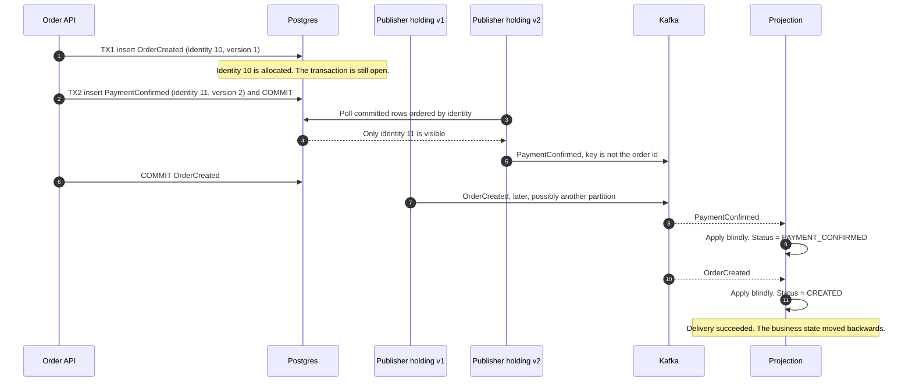
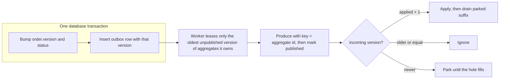

# Ordered outbox

An outbox gives you atomicity. It does not, by itself, give you event order.

This project is a small, runnable reference for that distinction. An order moves `CREATED → PAYMENT_CONFIRMED → SHIPPED`, and each transition is written to Postgres in the same transaction as an outbox row. Two relays then publish those rows to Kafka:

- **Naive mode** reproduces the race. Concurrent publishers claim rows by database identity, a higher version can be acknowledged first, the record key is not the aggregate, and the consumer applies whatever arrives. The projection status moves backwards.
- **Safe mode** keeps one aggregate in one lane. The business version is stamped in the writing transaction, only one publisher owns that aggregate, Kafka is keyed by the aggregate id, and the consumer applies the next version, ignores duplicates, and parks a gap until the missing version shows up.

Both modes are the same application. `outbox.mode` chooses the startup mode, and `PUT /admin/mode` flips it without a restart so the demo can show both.

The race this demonstrates was described by Felipe Pereira: [An Outbox guarantees atomicity. But does it guarantee event ordering?](https://lnkd.in/p/d4cfEGZ5)

## The race

`OrderCreated`, `PaymentConfirmed`, and `OrderShipped` are one business sequence. Atomic insert does not mean the broker sees them in that sequence. A generated id is allocated when the `INSERT` runs, not when the transaction commits, and two publishers can be in flight for the same order at once.



Reliable delivery and ordered processing are different problems. The outbox solves the first. The four constraints below are what the second one actually needs.

## Four ordering constraints

1. **A generated id is not commit order.** Postgres `IDENTITY` / `nextval` advances when the statement runs. Another transaction can insert a higher id and commit while the lower id is still uncommitted. A poll of "visible rows ordered by id" then publishes the later business event first. The test `generatedIdIsNotCommitOrder` opens two connections and shows the higher id becoming visible first.

2. **Publisher concurrency breaks per-aggregate order.** Skip-locked claims are a good queue, and a bad sequencer. Two workers can hold version 1 and version 2 of the same order. The one that finishes its send first wins, whatever the business version says. Throughput goes up. Order does not come along for free.

3. **Kafka orders a partition, not a topic.** Records that share a key share a partition, and a partition is ordered. A null key, a random key, or a round-robin partitioner puts `OrderCreated` and `OrderShipped` on different partitions. No consumer group can put them back. The safe relay sets the key to the aggregate id.

4. **The consumer can undo a partition's order.** If the handler acks and then applies on a pool, a slow version 1 and a fast version 3 finish out of business order even when the poll was correct. The naive consumer does that on purpose: lower versions wait longer. The safe consumer applies on the poll thread, before the record is done.

## What safe mode actually does



**Version at write time.** `customer_order.version` is the business sequence. Creating an order writes version 1, payment writes 2, shipment writes 3, in the same transaction as the outbox row. A unique constraint on `(aggregate_id, aggregate_version)` makes a double-write fail. The identity column is still there, and it is still not the order.

**One in-flight publish per aggregate.** The aggregate id is hashed onto a shard (`UUID.hashCode()` is stable across JVMs). Worker `n` of `N` owns `shard % N`. Its claim is:

- unpublished,
- not leased, or the lease is older than `outbox.claim-lease` (60s),
- the minimum unpublished version of that aggregate,
- `FOR UPDATE SKIP LOCKED`.

It sends that one row, waits for the broker ack, marks it published, and only then can the next version be leased. Other aggregates on other shards proceed in parallel. A crash after the ack and before the mark republishes the row when the lease expires. That is at-least-once, which is why the consumer is idempotent.

**Kafka key.** Safe publishes use `key = aggregateId` and do not pin a partition. With more than one partition, every version of an order lands on the same one, in the order the single owner sent them. `max.in.flight.requests.per.connection=1` keeps a single producer from reordering its own retries. The key is what still works when you run more than one publisher process.

**Consumer gate.** Applied version `0` means nothing applied. The next legal version is `applied + 1`.

| Incoming version | Action |
| --- | --- |
| equal to applied + 1 | Apply it. Then apply any parked versions that now form a contiguous suffix. |
| less than or equal to applied | Ignore. Duplicate or stale. |
| greater than applied + 1 | Insert into `parked_event` and keep reading. Other aggregates on the partition are not blocked. |

Parking is a choice. Blocking the partition until the gap fills also preserves order, and it head-of-line blocks every other aggregate that hashed onto that partition. The parking table is the trade for letting the rest of the partition move.

`sourceCommitTime` is written on the payload from the application clock inside the transaction. It is for downstream analytics. It is not a total order. The version is the order.

## Trade-offs

**Throughput versus order.** Safe mode is parallel across aggregates and serial within one. A hot aggregate is a single lane: one worker, one in-flight send, one partition. That is the point. If most of the traffic is one aggregate, sharding will not save you; you have one sequence, and it has to be a sequence.

**Rebalancing.** `shard % workers` moves aggregates when `outbox.workers` changes. The lease token stops a second worker from marking a row it does not own. After the lease expires, the new owner can republish a row that was already acked. The consumer ignores the older version. Change the worker count on purpose, and keep it stable in steady state. The shard count (`outbox.shards`, default 32) should stay fixed; it is stored on the row. Keep `workers <= shards` or some workers sit idle.

**Why the version sidesteps commit order.** You do not need a global commit clock to order one aggregate. The transaction that changes the order assigns the next version and inserts the event. Readers can see those rows in any order. The number on the event is the order. Identity gaps, sequence cache, and commit delay stop mattering.

**Naive mode is instrumented so the race is repeatable.** Real schedulers lose the race sometimes. A demo that only fails on Tuesdays is not a demo. With `outbox.naive.stall-lower-versions=true` (the default), each claimed batch publishes the higher version of an aggregate before it releases the lower one. That is a slow worker, written so the test can see it every run. Set the flag to false and the same claim loop races for real, without a guaranteed loser. Naive records also use a random key and are pinned to partition 0, so the broker retains the wrong send order instead of hiding it behind a multi-partition catch-up read. `outbox.naive.async-consumer=true` schedules the apply with a longer delay for lower versions, which is constraint 4 on its own. The async test submits versions 1, 2, 3 in that order and still watches the projection land on `CREATED`.

## Run it

Java 21. Docker is required for tests and for compose. `./mvnw quarkus:dev` does not need a local Postgres or Kafka: Quarkus Dev Services starts both via Testcontainers.

```bash
./mvnw quarkus:dev
```

Swagger UI is at <http://localhost:8080/q/swagger-ui>. The useful calls:

| Call | What it does |
| --- | --- |
| `POST /orders` | `{ "customerRef": "ada" }` → `OrderCreated` |
| `POST /orders/{id}/payment` | `{ "paymentRef": "pay-1" }` |
| `POST /orders/{id}/shipment` | `{ "trackingNumber": "track-1" }` |
| `GET /orders/{id}` | Write model, projection, relay order, applied order, parked versions |
| `PUT /admin/mode` | `{ "mode": "naive" }` or `"safe"` |
| `POST /demo/burst` | Pause publishers, write N full orders, resume |
| `POST /admin/publishers/pause` and `/resume` | Hold the relay while you stage rows |
| `GET /admin/summary` | Pending outbox rows and how many projections regressed |
| `GET /q/health/ready` | Postgres, Kafka, and the app |

Compose runs the same jar against a real Postgres 16 and Kafka (KRaft, 6 partitions). The app joins Kafka on the internal listener; `localhost:9092` is there if you want a host client.

```bash
docker compose up --build
./scripts/demo.sh
./scripts/load.sh
```

`demo.sh` runs a naive burst and expects at least one order to regress, then a safe burst and expects every order to end `SHIPPED` with relay and apply order `1, 2, 3`. `load.sh` creates orders concurrently (default 24, override with `COUNT` and `PARALLEL`) in safe mode and exits non-zero if any projection regresses. `BASE_URL` overrides `http://localhost:8080`.

Startup mode is `OUTBOX_MODE` (`safe` by default). The rest of the knobs are in `src/main/resources/application.properties`.

## Tests

```bash
./mvnw verify
```

Dev Services (Testcontainers) starts Postgres and Kafka for `@QuarkusTest`. Docker has to be running. Unit tests do not need it, but `verify` runs both.

| Test | What it locks in |
| --- | --- |
| `VersionGateTest` | Accept, ignore, park, and contiguous drain |
| `VersionDelayTest` | Lower versions wait longer on the async applier |
| `AggregateShardTest` | Shard assignment is stable |
| `generatedIdIsNotCommitOrder` | A higher identity can be visible before a lower one commits |
| `duplicateAggregateVersionIsRejected` | One version per aggregate |
| `restHappyPathReachesShippedInOrder` | The HTTP flow, and a legal transition, in safe mode |
| `safeConsumerParksGapsAndIgnoresDuplicates` | v1, then v3 parks, v3 again is a no-op, v2 drains through v3, replays do not append |
| `naiveModeAppliesEventsOutOfOrder` | Eight orders, relay and apply order `3, 2, 1`, final status `CREATED` |
| `safeModeStaysOrderedUnderConcurrentPublishers` | Twelve orders stay `1, 2, 3`, a redelivered v2 is ignored, and every version of an order shares a Kafka partition |
| `asyncConsumerReordersAnAlreadyOrderedBatch` | Versions submitted in order still apply backwards |

GitHub Actions runs `./mvnw verify` on pull requests and on `main`.

## Layout

```
domain/        order, sealed events, the transactional write
outbox/        append, naive relay, safe relay, shard, claim lease
messaging/     keyed producer, consumer, async naive apply
projection/    version gate, parking table, projection log
api/           orders, admin, demo burst
```

The projection log is the apply order. The relay log is the publish order. `GET /orders/{id}` returns both, which is the whole demo.

## Credit

Felipe Pereira, [An Outbox guarantees atomicity. But does it guarantee event ordering?](https://lnkd.in/p/d4cfEGZ5). The implementation choices here (shard ownership, the parking table, the stall that makes the naive race deterministic) are this repository's. The problem statement is his.
